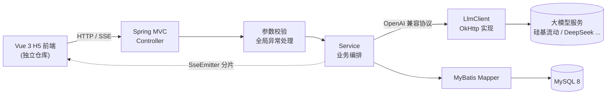

# Travel Java · AI 旅游规划助手（后端）

> 一个可落地、可测试的 AI 旅游规划后端：输入城市、天数和预算，由大模型生成结构化行程；支持 SSE 实时问答、用户体系、历史记录与收藏。


## 项目简介

这个项目把常见的「调一次大模型 API」demo，做成了一套完整的后端服务：

- **行程规划**：根据城市、天数、预算生成逐日行程（上午 / 下午 / 晚上）、预算明细、贴士与注意事项，并以 JSON 结构化落库。
- **AI 旅游咨询**：通过 SSE 流式返回，前端可以边生成边展示，而不是等一整段回答。
- **用户体系**：注册、登录、退出、修改昵称与密码，登录态使用 JWT + HttpOnly Cookie。
- **历史与收藏**：每次生成的行程自动归档，支持按用户查询、查看详情、收藏 / 取消收藏、删除。
- **对话记录**：聊天消息与 AI 回复落库，可按用户回看。

技术栈以 Spring Boot 4 + Spring MVC 为主，数据层用 MyBatis 直接写 SQL，大模型调用基于 OkHttp 适配 OpenAI 兼容协议。

<!-- TODO: 如果前端也开源，在这里补充 H5 前端仓库链接（Vue 3 + Vant） -->

## 功能一览

| 模块 | 能力 |
| --- | --- |
| 智能行程规划 | 城市 + 天数 + 预算 → 结构化行程，自动入库 |
| AI 实时咨询 | SSE 流式输出，支持分片、完成、错误三类事件 |
| 用户认证 | BCrypt 密码哈希、JWT 签发、HttpOnly Cookie、登录态校验 |
| 历史管理 | 行程列表、详情、收藏状态、删除 |
| 聊天记录 | 用户消息与 AI 回复落库、按用户查询 |
| 参数校验 | Jakarta Validation + 全局异常处理，错误信息直接可展示 |

## 技术栈

| 分类 | 选型 | 说明 |
| --- | --- | --- |
| 语言 / 运行时 | Java 17 | `record`、`switch` 表达式、文本块等新特性 |
| Web 框架 | Spring Boot 4.1.1 / Spring MVC | 异步 SSE 基于 `SseEmitter` |
| 数据访问 | MyBatis 4.1.0 | 注解 SQL + XML 动态 SQL |
| JSON 列映射 | MyBatis-Plus `JacksonTypeHandler` | 仅用于 `t_trip` 的 JSON 字段读写 |
| 数据库 | MySQL 8 | 行程、用户、收藏、聊天四张表 |
| HTTP 客户端 | OkHttp 4.12 | 调用 OpenAI 兼容的 `/chat/completions` |
| 序列化 | Jackson | 请求体构造、响应解析、JSON 列映射 |
| 认证 | JJWT 0.9.1 + Spring Security Crypto | HS256 签发 JWT、BCrypt 校验密码 |
| 参数校验 | Jakarta Validation | 城市非空、天数 1–30、预算 100–1,000,000 |
| 测试 | JUnit 5 / Mockito / MockMvc / Testcontainers | 单元、切片、真 MySQL 集成测试 |
| 覆盖率 | JaCoCo | `mvn test` 后生成 HTML 报告 |

## 系统架构



两条核心链路：

1. **行程规划（同步）**：`Controller → TravelService → LlmClient.chat → LlmResponseParser → HistoryService`（写入 `t_trip` 与 `t_search`）。
2. **AI 咨询（流式）**：`Controller → SseEmitter → 线程池 → LlmClient.chatStream → ChatStreamHandler → SSE 事件`。

## 快速开始

### 环境要求

- JDK 17+
- Maven 3.9+
- MySQL 8.x
- 可选：Docker（用于运行 Testcontainers 集成测试，没有 Docker 时该测试类自动跳过）

### 1. 创建数据库

建库并导入表结构（完整 DDL 见下方「数据库设计」）：

```sql
CREATE DATABASE IF NOT EXISTS travel_db
  DEFAULT CHARACTER SET utf8mb4
  COLLATE utf8mb4_0900_ai_ci;
```

### 2. 配置

`src/main/resources/application.yml` 中已经给出本地默认配置，按需修改：

```yaml
server:
  port: 3200

spring:
  datasource:
    url: jdbc:mysql://localhost:3306/travel_db
    username: root
    password: 你的密码

llm:
  base-url: https://api.siliconflow.cn/v1   # 任何 OpenAI 兼容服务都可以
  model: zai-org/GLM-5.3-Flash
  api-key: ${LLM_API_KEY:}                  # 推荐用环境变量注入
```

推荐用环境变量覆盖敏感配置，不要把密钥提交到仓库：

```bash
# macOS / Linux
export LLM_API_KEY="sk-xxxxxxxx"
export SPRING_DATASOURCE_PASSWORD="你的密码"

# Windows PowerShell
$env:LLM_API_KEY = "sk-xxxxxxxx"
$env:SPRING_DATASOURCE_PASSWORD = "你的密码"
```

### 3. 启动

```bash
mvn spring-boot:run
```

服务默认监听 `http://localhost:3200`。

### 4. 验证

先注册一个账号，服务会通过 `Set-Cookie` 下发 `access_jwt`：

```bash
curl -i -X POST http://localhost:3200/api/travel/register \
  -H "Content-Type: application/json" \
  -d '{"username":"13800000000","passwordHash":"123456","nickname":"小旅"}'
```

带上 Cookie 生成一次行程：

```bash
curl -X POST http://localhost:3200/api/travel/recommend \
  -H "Content-Type: application/json" \
  -H "Cookie: access_jwt=<上一步响应里的 token>" \
  -d '{"city":"成都","days":3,"budget":5000,"userId":1}'
```

流式问答（`-N` 关闭 curl 缓冲，可以看到分片逐条到达）：

```bash
curl -N -X POST http://localhost:3200/api/travel/chat \
  -H "Content-Type: application/json" \
  -H "Cookie: access_jwt=<token>" \
  -d '{"message":"去成都三天怎么玩？"}'
```

## 接口一览

除 `/login`、`/register` 外，所有接口都需要携带名为 `access_jwt` 的 Cookie。

| 方法 | 路径 | 说明 | 主要参数 |
| --- | --- | --- | --- |
| GET | `/api/travel/hello` | 健康检查 | — |
| POST | `/api/travel/recommend` | 生成行程并入库 | JSON：`city`、`days`、`budget`、`userId` |
| POST | `/api/travel/chat` | AI 咨询（SSE） | JSON：`message` |
| POST | `/api/travel/login` | 登录 | JSON：`username`、`passwordHash`、`nickname` |
| POST | `/api/travel/register` | 注册 | JSON：`username`、`passwordHash`、`nickname` |
| POST | `/api/travel/logout` | 退出（清除 Cookie） | — |
| POST | `/api/travel/update_nickname` | 修改昵称 | `userId`、`nickName` |
| POST | `/api/travel/update_pwd` | 修改密码 | `userId`、`oldPassword`、`newPassword` |
| POST | `/api/travel/history` | 行程列表 | `userId`、`collected` |
| POST | `/api/travel/tripDetail` | 行程详情 | `id`（搜索记录 id） |
| POST | `/api/travel/collected` | 收藏 / 取消收藏 | `id`、`collected` |
| POST | `/api/travel/checkCollect` | 查询收藏状态 | `id` |
| POST | `/api/travel/delete_trip` | 删除行程 | `id` |
| POST | `/api/travel/chatget` | 查询聊天记录 | `userId` |
| POST | `/api/travel/chatsave` | 保存一条聊天记录 | JSON：`userId`、`userMsg`、`aiMsg` 等 |

统一响应结构：

```json
{
  "success": true,
  "code": 200,
  "message": "success",
  "data": {},
  "error": null,
  "rawResponse": null
}
```

### 行程规划响应示例

```json
{
  "success": true,
  "code": 200,
  "message": "success",
  "data": {
    "success": true,
    "city": "成都",
    "days": 3,
    "totalBudget": 5000.0,
    "dailyItinerary": [
      {
        "day": 1,
        "date": "第1天",
        "morning": {
          "spot": "武侯祠",
          "duration": "2小时",
          "ticket": "50元",
          "transportation": "地铁3号线",
          "description": "了解三国文化的经典景点"
        },
        "afternoon": {},
        "evening": {}
      }
    ],
    "budgetBreakdown": {
      "accommodation": 1500.0,
      "food": 1000.0,
      "transportation": 600.0,
      "tickets": 500.0,
      "other": 400.0
    },
    "tips": ["提前预订酒店"],
    "warnings": ["热门景点注意错峰"]
  }
}
```

### 流式事件格式

SSE 的每个 `data:` 都是一段 JSON，事件分三类：

```
data:{"type":"chunk","content":"成都"}
data:{"type":"chunk","content":"三天"}
data:{"done":true}
```

出现异常时会返回 `{"error":"..."}`，前端据此结束渲染并提示用户。

## 数据库设计

| 表 | 作用 | 关键点 |
| --- | --- | --- |
| `t_user` | 用户 | `username` 唯一，密码只存 BCrypt 哈希 |
| `t_trip` | 行程主表 | 行程、预算明细、贴士等以 JSON 列存储 |
| `t_search` | 用户与行程的关联 | 记录生成历史与收藏状态，唯一键 `(user_id, trip_id)` |
| `t_chat` | 聊天记录 | 用户消息与 AI 回复成对保存 |

<details>
<summary>展开查看建表 SQL</summary>

```sql
CREATE TABLE IF NOT EXISTS `t_user` (
  `id` bigint unsigned NOT NULL AUTO_INCREMENT COMMENT '主键',
  `username` varchar(50) NOT NULL COMMENT '登录名（电话号码）',
  `password_hash` varchar(100) NOT NULL COMMENT '密码哈希值',
  `nickname` varchar(50) DEFAULT NULL COMMENT '用户昵称',
  `avatar` varchar(255) DEFAULT NULL COMMENT '用户头像',
  `status` tinyint NOT NULL DEFAULT '1' COMMENT '用户状态，1-正常，0-禁用',
  `create_time` datetime NOT NULL DEFAULT CURRENT_TIMESTAMP COMMENT '创建时间',
  PRIMARY KEY (`id`),
  UNIQUE KEY `uk_username` (`username`)
) ENGINE=InnoDB DEFAULT CHARSET=utf8mb4 COMMENT='用户表';

CREATE TABLE IF NOT EXISTS `t_trip` (
  `id` bigint unsigned NOT NULL AUTO_INCREMENT COMMENT '主键',
  `city` varchar(50) NOT NULL COMMENT '城市',
  `days` int NOT NULL COMMENT '天数',
  `budget_breakdown` json DEFAULT NULL COMMENT '预算明细',
  `tips` json DEFAULT NULL COMMENT '温馨提示',
  `warnings` json DEFAULT NULL COMMENT '注意事项',
  `daily_itinerary` json DEFAULT NULL COMMENT '行程计划',
  `total_budget` decimal(10,2) DEFAULT NULL COMMENT '预算金额',
  PRIMARY KEY (`id`)
) ENGINE=InnoDB DEFAULT CHARSET=utf8mb4 COMMENT='行程表';

CREATE TABLE IF NOT EXISTS `t_search` (
  `id` bigint unsigned NOT NULL AUTO_INCREMENT COMMENT '主键',
  `user_id` bigint unsigned NOT NULL,
  `trip_id` bigint unsigned NOT NULL,
  `create_time` datetime NOT NULL DEFAULT CURRENT_TIMESTAMP COMMENT '生成时间',
  `is_collected` tinyint NOT NULL DEFAULT '0' COMMENT '是否收藏，1-已收藏',
  PRIMARY KEY (`id`),
  UNIQUE KEY `uk_user_trip` (`user_id`,`trip_id`),
  KEY `idx_user_collected_created` (`user_id`,`is_collected`,`create_time`),
  CONSTRAINT `fk_search_trip` FOREIGN KEY (`trip_id`) REFERENCES `t_trip` (`id`) ON DELETE CASCADE,
  CONSTRAINT `fk_search_user` FOREIGN KEY (`user_id`) REFERENCES `t_user` (`id`) ON DELETE CASCADE
) ENGINE=InnoDB DEFAULT CHARSET=utf8mb4 COMMENT='搜索表';

CREATE TABLE IF NOT EXISTS `t_chat` (
  `id` bigint unsigned NOT NULL AUTO_INCREMENT COMMENT '主键',
  `user_id` bigint unsigned NOT NULL COMMENT '用户id',
  `user_msg` text COMMENT '用户消息',
  `user_time` datetime NOT NULL DEFAULT CURRENT_TIMESTAMP COMMENT '用户消息时间',
  `ai_msg` text COMMENT 'AI消息',
  `ai_time` datetime NOT NULL DEFAULT CURRENT_TIMESTAMP COMMENT 'AI消息时间',
  PRIMARY KEY (`id`),
  KEY `fk_chat_user` (`user_id`),
  CONSTRAINT `fk_chat_user` FOREIGN KEY (`user_id`) REFERENCES `t_user` (`id`) ON DELETE CASCADE
) ENGINE=InnoDB DEFAULT CHARSET=utf8mb4 COMMENT='聊天记录表';
```

</details>

## 项目结构

```text
travel-java/
├── src/main/java/org/example/traveljava/
│   ├── controller/            # 行程规划、AI 咨询、登录、历史、聊天记录
│   ├── service/               # 业务编排、SSE 事件转换
│   ├── llm/                   # LlmClient 抽象 + OkHttp 实现 + 配置 + 响应解析
│   ├── Mapper/                # MyBatis Mapper（注解 SQL + XML）
│   ├── dto/ vo/               # 请求参数、统一响应、领域对象
│   ├── common/                # 全局异常、参数校验、MyBatis、BCrypt 配置
│   ├── filter/                # JWT 登录态过滤器
│   └── utils/                 # JWT 工具
├── src/main/resources/
│   ├── application.yml
│   └── org/example/traveljava/mapper/HistoryMapper.xml
├── src/test/java/...          # 16 个测试类 + 1 个假 LLM 服务
└── pom.xml
```

## 测试

```bash
mvn test
```

覆盖范围：

- **Controller 切片测试**：用 `@WebMvcTest` + `MockMvc` 验证路由、参数校验边界、SSE 响应头与登录态。
- **Service 单元测试**：用 Mockito 隔离 Mapper 与 LLM 客户端。
- **LLM 客户端测试**：自建一个基于 JDK `HttpServer` 的假模型服务，覆盖超时、非 2xx、非法 JSON、SSE 分片、特殊字符转义。
- **Mapper 集成测试**：Testcontainers 启动 MySQL 8.4，跑真实 SQL 与 JSON 列映射；本机没有 Docker 时整类自动跳过。

覆盖率报告生成在 `target/site/jacoco/index.html`。

## Roadmap

- [ ] 会话记忆：把多轮对话写入 Redis，让 AI 咨询能记住上下文（代码中已预留 `ChatStreamHandler#getFullText`）
- [ ] 多模型供应商：按配置切换不同的 `LlmClient` 实现
- [ ] 接口文档：接入 springdoc-openapi，自动生成 Swagger UI
- [ ] 部署：补充 Dockerfile 与 docker-compose（应用 + MySQL）
- [ ] 安全加固：JWT 密钥、数据库密码全部改为环境变量注入
- [ ] 字段命名统一：请求体中的 `passwordHash` 改为 `password`，避免误导

## License

MIT License。如仓库中尚未添加 `LICENSE` 文件，可按需补充。

---

如果这个项目对你有帮助，欢迎点个 Star ⭐
